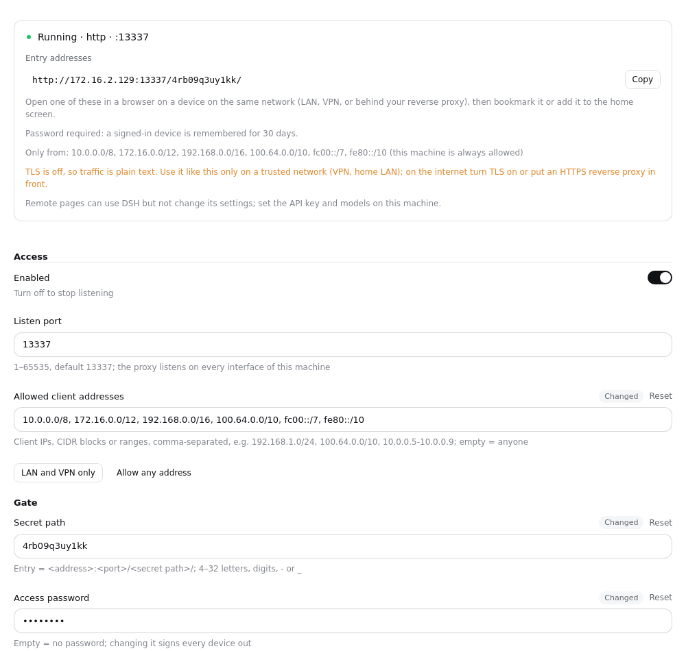

# dsh-remote-access-proxy

[English](README.md) · [简体中文](README.zh-CN.md)

Use DSH (DeepSeek Harness) from your phone, tablet, or another computer's browser.

The plugin runs a small reverse proxy inside DSH. A remote device opens one address with a random path and gets the full Web GUI, without ever needing the launch token DSH changes on every start. Anything can sit in front: a LAN IP, easytier, ZeroTier, Tailscale, nginx, Caddy, Cloudflare Tunnel.

Requires **DSH 0.1.7-rc.1 or newer** (tested on 0.2.0-rc.2 and 0.2.1-alpha.3).

## Three steps

1. **Install**: sidebar **Plugins** → Add plugin, and give it
   ```
   https://github.com/citydirector/dsh-remote-access-proxy
   ```
   Switch it on.
2. **Get the address**: open **Remote Access Proxy** in the plugin list, then the **Remote Access Proxy** component under it. The top of the page shows whether it is running and the **entry addresses**. Click **Copy**.
3. **Open it remotely**: on a device on the same network, open the address in a browser, e.g. `http://192.168.1.20:13337/k3x9q2m7p1zt/`. Bookmark it or add it to the home screen.

Nothing needs configuring: port 13337 on every interface, with the random path generated and saved on first start. Add a password or limit who may connect whenever you like.

> **Set your API key on this machine first.** Some DSH settings can only be changed from a page on the host (DSH's own rule, not this plugin's; on 0.2.0 remote pages cannot change settings at all), so set the API key in DSH on the host. Remote pages can create sessions, chat, and pick workspaces normally.

## The configuration page



- **Status**: running, off, or not running — and when it failed, why and what to do ("Port 13337 is already in use", "The certificate could not be loaded"), instead of a line buried in a log.
- **Entry addresses**: one per network interface, each with a copy button.
- **Allowed client addresses**: which devices may connect — IPs, CIDR blocks or ranges, e.g. `192.168.1.0/24, 100.64.0.0/10`. **LAN and VPN only** fills in every private range in one click; empty means anyone. Connections from elsewhere are dropped before a byte is exchanged, and the page tells you the last address it turned away, so you can add your own device if you locked it out. This machine itself is always allowed.
- **Access password** (optional): the entry then shows a sign-in page. A signed-in device is remembered for 30 days; changing the password signs every device out. Five wrong tries lock that address for a few minutes. `<entry>/__rap/logout` signs a device out.
- **Regenerate the entry path**: after saving, the old address stops working — use it if the address may have leaked.
- On/off settings are switches. A save applies at once: the proxy restarts in place, DSH does not.

On DSH 0.2.0 the page appears on the host only; from 0.2.1 remote pages can open it too, but **one-click updates are offered on the host only**.

## Do I need TLS?

No. DSH 0.2 works over plain http.

- **VPN / home LAN**: http is fine; the traffic is already on a private network.
- **Internet**: turn TLS on, or put the proxy behind an HTTPS reverse proxy (Caddy, nginx, Cloudflare Tunnel).

TLS needs a `.pfx` certificate. A self-signed one on Windows (PowerShell):

```powershell
$cert = New-SelfSignedCertificate -DnsName "dsh.local" -CertStoreLocation Cert:\CurrentUser\My -NotAfter (Get-Date).AddYears(5)
Export-PfxCertificate -Cert $cert -FilePath .\data\certs\dsh-proxy.pfx -Password (ConvertTo-SecureString "your-passphrase" -AsPlainText -Force)
```

On macOS / Linux (openssl):

```bash
openssl req -x509 -newkey rsa:2048 -nodes -days 1825 -subj "/CN=dsh.local" -keyout key.pem -out cert.pem
openssl pkcs12 -export -inkey key.pem -in cert.pem -out dsh-proxy.pfx -passout pass:your-passphrase
```

Then switch on "Enable TLS" in the page, fill in the path and passphrase, and save. Browsers ask you to accept the certificate once. With TLS the gate cookie also gets the `Secure` flag.

## Troubleshooting

| The page says | Do this |
|---|---|
| Port … is already in use | Pick another port, or close what holds it. Two DSH apps sharing one `data` directory (portable + desktop) do this too — see below |
| These client addresses aren't valid | Write an IP (`10.0.0.5`), a CIDR block (`10.0.0.0/24`) or a range (`10.0.0.5-10.0.0.9`) |
| The certificate could not be loaded | Check the path (relative to DSH's working directory) and the passphrase |
| Can't read the proxy status | The plugin isn't running: check both the plugin's and the component's switches |

- **The remote device can't connect at all** (connection reset): its address isn't in the allow list. The page shows the address it turned away; add it, or click **LAN and VPN only**.
- **`forbidden` on the remote device**: the path is wrong. Open the full entry address again.
- **Two DSH apps sharing one `$DSH_HOME`** read the same profile and fight over one port. Switch "Enabled" off in one of them, or give each its own port.

## Security model

Access control is entirely the proxy's gate:

- **Allow list**: a client outside `allowFrom` is dropped at the TCP level (before TLS), like a firewall rule. Loopback is always allowed, so a local HTTPS reverse proxy keeps working;
- **Random path**: the entry is `<address>:<port>/<secretPath>/`, generated from the OS CSPRNG;
- **Password** (optional): without it the path alone opens the site; with it the entry shows a sign-in form, failed tries are slowed and rate-limited per address;
- **Remembered device**: entering (or signing in) sets `dsh_et_gate`, a signed value that expires after 30 days (`Path=/; Max-Age=2592000; HttpOnly; SameSite=Strict`, plus `Secure` with TLS). It is signed with a server secret over the path and the password, so changing either — or regenerating the path — revokes every device. Nobody ever edits it by hand.

The proxy forwards to DSH as loopback (Host rewritten to `127.0.0.1:<port>`, Origin stripped) and **performs the launch-token exchange itself, holding the `dsh-auth-*` cookie**, so remote users never see the per-start token. On an upstream 401 it drops that cookie and exchanges again.

The path is the key: treat the entry address like a password. The `access.log` startup line records it too.

## Configuration

Every field is a `.volatile()` field of the plugin's Cordis `Config`, stored in the active profile's `cordis.patch.yml`. Edit them in the page, or by hand from [`config/cordis.patch.example.yml`](config/cordis.patch.example.yml).

| Field | Description |
|---|---|
| `enabled` | Stop listening when off |
| `listenPort` | Port (default `13337`); the proxy listens on every interface, IPv4 and IPv6 |
| `allowFrom` | Client addresses allowed to connect: IPs, CIDR blocks, `a-b` ranges, separated by commas or spaces. Empty = anyone; loopback always |
| `secretPath` | Gate path (4–32 letters, digits, `-`, `_`; generated when empty) |
| `password` | Optional access password (empty = none) |
| `cookieValue` | Server secret that signs remembered devices (generated; not shown on the page) |
| `upstreamHost` / `upstreamPort` | Upstream DSH. Empty / `0` follows the running instance: 3080 for `dsh web`, 19387 for the desktop app |
| `tlsEnabled` / `tlsPfxPath` / `tlsPassphrase` | TLS (pfx certificate) |
| `logMaxBytes` / `logKeep` | `access.log` rotation: rotate past the cap (default 1 MiB), keep this many old files (default 3); `0` turns rotation / history off |
| `updateCheck` | Check for updates (default on): read the release tags on GitHub a few seconds after start and every 12 hours; it only tells you, never installs |

## Updating

### One-click update (1.4+)

A few seconds after start, and every 12 hours after that, the plugin reads this repository's tags on GitHub, takes the highest `vX.Y.Z` (pre-releases and other tags are ignored) and compares it with the running version. The **Version** line of the status card says **Up to date**, **vX is available**, or **Couldn't check for updates** (with the time and the reason). Offline or rate-limited checks just show as failed; the proxy is not affected. **Check now** checks again at once; turn **Check for updates** off under Advanced if you don't want it to go online.

When a release is available, click **Update to vX**. The page asks DSH's own plugin manager (the same call the Plugins page installs with) to install `github:citydirector/dsh-remote-access-proxy#vX`; DSH installs it over the running version and hot-swaps it, no restart needed:

- **Updated to vX**: the new version is running. The entry path, password and allow list live in the profile and stay as they were; signed-in devices stay signed in.
- **Installed; takes effect after DSH restarts**: DSH could not hot-swap this change and the page says why (for example the profile has no hot reload, or the plugin was installed from another source before). Restart DSH.
- **Didn't work**: the reason and the full output, plus a **Roll back to vOld** button. If the new version installed but failed to start, DSH hides the plugin's own page, so the outcome and the rollback button show in a card at the bottom right of the window.

The update button is only offered on a page opened on this computer; remote pages only say a release is available. The plugin never updates itself.

To update or roll back by hand: **Plugins** → **Add plugin**, and give it a tag-pinned spec such as `github:citydirector/dsh-remote-access-proxy#v1.4.0`. A spec without a tag, or exactly the spec already installed, is refused as already installed.

### Upgrading from 1.3 to 1.4

1.3 has no update button, so install 1.4.0 once by hand: **Plugins** → **Add plugin**, and give it

```
github:citydirector/dsh-remote-access-proxy#v1.4.0
```

From DSH 0.2.1 it installs over 1.3 and hot-swaps (tested from 1.3.0: entry path, password and allow list kept). Later releases update from the configuration page. DSH 0.2.0 and older have no hot reload: `pnpm add` that spec in the profile directory, then restart DSH.

### Release convention

1. Bump `version` in `package.json`, e.g. `1.4.1`.
2. Commit and push to `main`.
3. Tag `v1.4.1` (exactly `v` + three numbers) and push the tag: `git tag v1.4.1 && git push origin v1.4.1`.

Only `vX.Y.Z` tags count as releases; a pre-release such as `v1.5.0-rc.1` is never offered. Each release installs from its own tag, which is what lets DSH install it over the previous one — so **every release needs its tag**.

## Upgrading from 1.2

- `listenHost` is gone: the proxy now always listens on every interface, and **who** may connect is `allowFrom`. An old `listenHost` value is ignored.
- Devices enter through the path once more after upgrading (the cookie format changed); bookmarked addresses keep working.

## Upgrading from 1.1

Nothing to do:

- 1.1 named its components by relative path, and DSH's first configuration save expanded that into an **absolute path** in the profile — so a portable install stopped loading the plugin once its folder moved.
- 1.2 loads by package name. On its first start it rewrites that stale absolute path in the profile to the package name and **keeps your gate path and cookie**, so bookmarked addresses keep working.
- The two components (proxy + page) are now one, shown in the Plugins page with a proper title and icon instead of a long `file:///…` path.

### Migrating from 0.3.0

DSH 0.1.7 removed `settings.yaml`. Update DSH first, then the plugin, and switch it off and on. On first start DSH imports the `remote-access-proxy:` section of `data/settings.yaml` into the profile and renames the file to `settings.yaml.imported`.

## Manual install / CLI

```bash
dsh plugin --profile web add github:citydirector/dsh-remote-access-proxy
```

A git dependency is pinned to a commit by the profile's `pnpm-lock.yaml`; prefer a tag-pinned spec (`github:citydirector/dsh-remote-access-proxy#v1.4.0`). While DSH runs, update from the configuration page or the Plugins page; with DSH stopped you can also `pnpm add` the new tag in the profile directory.

## Development

```
dsh-remote-access-proxy/
├── package.json                        # bundle manifest + dsh.client; "." = proxy, "./client" = page
├── cordis.patch.yml                    # the one row this bundle inserts (by package name)
├── plugin/dsh-remote-access-proxy.mjs  # host: gate + forwarding + status route
├── client/index.js                     # browser: the configuration page
├── config/cordis.patch.example.yml     # hand-configuration template
├── locale/{en,zh}.json                 # Plugins-page title and description
└── test-remote-access-proxy.mjs        # end-to-end tests against a mock DSH
```

```bash
pnpm install
node test-remote-access-proxy.mjs   # Expected: 86 passed, 0 failed
```

The tests mock a DSH upstream (launch-token exchange + `dsh-auth` cookie gate) and the host contract the plugin relies on, and cover the gate, cookie injection, token stripping, 303 rewrite, 401 self-heal, WS upgrade, log rotation, secret generation and write-back, the status route, failure reasons (invalid path, busy port, bad allow-list entry), the password sign-in (deep links, lockout, logout, revocation), the allow list (drop, loopback, reporting), the 1.1 → 1.2 migration, upstream auto-detect, the update check (tag filtering, version comparison, failures and rate limits, the switch, check now), closing every connection on a hot swap and rebinding the port at once, and the package layout.

The tests check for updates against a mock GitHub only. To rehearse a release in a real DSH, start DSH with `DSH_RAP_UPDATE_SOURCE` pointing elsewhere: `owner/repo` (another GitHub repository) or any git URL (for example a local bare repository with tags, `git+file:///path/to/repo.git`). The update button then installs `<source>#<tag>`.
