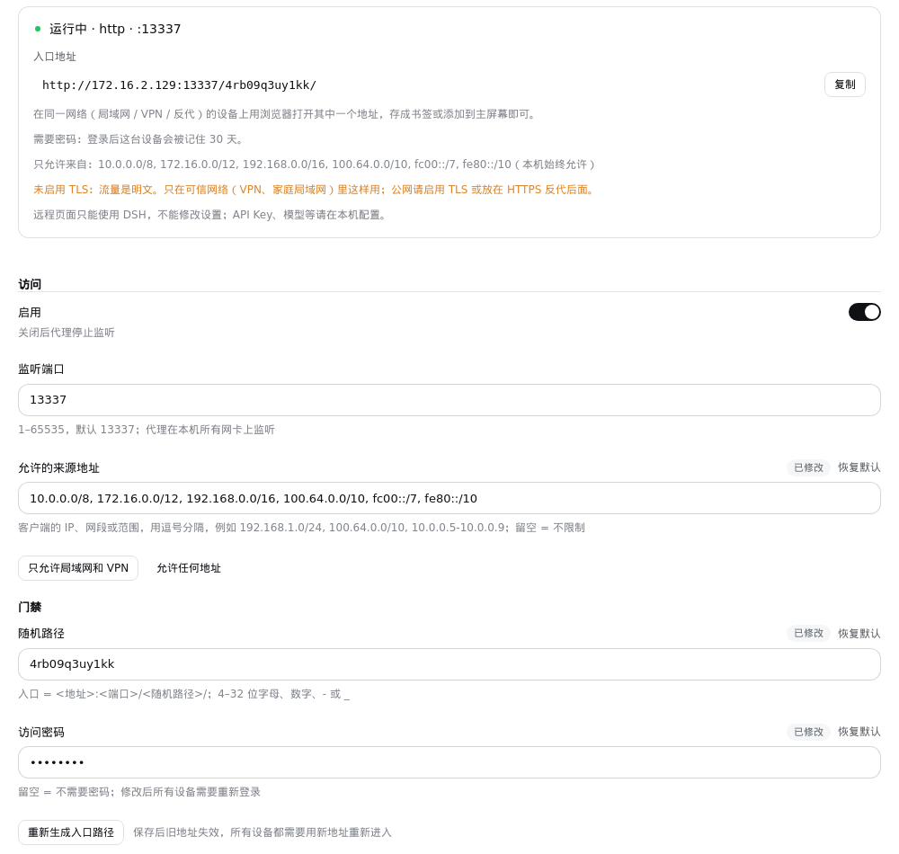

# dsh-remote-access-proxy

[English](README.md) · [简体中文](README.zh-CN.md)

在手机、平板或另一台电脑上用浏览器使用 DSH（DeepSeek Harness）。

插件在 DSH 里起一个小型反向代理：远程设备只要打开一个带随机路径的地址，就能用完整的 Web GUI，不用知道 DSH 每次启动都会变的 launch token。前面接什么都行：局域网 IP、easytier、ZeroTier、Tailscale、nginx、Caddy、Cloudflare Tunnel。

需要 **DSH 0.1.7-rc.1 或更新**（已在 0.2.0-rc.2 和 0.2.1-alpha.3 上实测）。

## 三步用起来

1. **安装**：侧边栏 **插件** → 添加插件，填入
   ```
   https://github.com/citydirector/dsh-remote-access-proxy
   ```
   装完打开开关。
2. **拿地址**：在插件列表打开 **远程访问代理**，再点它下面的 **远程访问代理** 组件。页面顶部显示运行状态和**入口地址**，点 **复制**。
3. **在远程设备上打开**：在同一网络的设备上用浏览器打开这个地址，例如 `http://192.168.1.20:13337/k3x9q2m7p1zt/`。存成书签或添加到主屏幕即可。

默认什么都不用配：端口 13337、监听所有网卡、随机路径首次启动自动生成并保存。需要时再加访问密码，或限制哪些设备能连。

> **先在本机配好 API Key。** DSH 的部分设置只能在本机页面修改（这是 DSH 自己的规则，不是插件限制；0.2.0 上远程页面完全不能改设置），所以 API Key 等要在本机的 DSH 里填。远程页面可以正常新建会话、聊天、选择工作区。

## 配置页



- **状态**：运行中 / 已关闭 / 未能启动。启动失败会直接写出原因和改法，例如「端口 13337 已被占用」「证书读不出来」，不用再去翻日志。
- **入口地址**：每块网卡一行，附复制按钮。
- **允许的来源地址**：哪些设备可以连进来，写 IP、网段或范围，例如 `192.168.1.0/24, 100.64.0.0/10`。点「只允许局域网和 VPN」一键填好所有私有网段；留空表示不限制。其它地址的连接在交换任何数据之前就会被断开，配置页会显示最近被拒绝的地址，把自己锁在外面时照着加回来即可。本机始终允许。
- **访问密码**（可选）：设置后入口会先显示登录页。登录过的设备记住 30 天；改密码会让所有设备重新登录。同一地址连续输错 5 次会被锁几分钟。打开 `<入口>/__rap/logout` 可以退出当前设备。
- **重新生成入口路径**：保存后旧地址立即失效，适合怀疑地址泄露的时候用。
- 开关类设置显示为开关；保存后立即生效，代理原地重启，不用重启 DSH。

在 DSH 0.2.0 上配置页只在本机页面出现；0.2.1 起远程页面也能打开它，但**一键更新只在本机页面提供**。

## 要不要开 TLS

不是必须的。DSH 0.2 在明文 http 下也能正常工作。

- **VPN / 家庭局域网**：用 http 就行，流量本身已经在私有网络里。
- **公网**：请开 TLS，或者把代理放在 HTTPS 反代（Caddy、nginx、Cloudflare Tunnel）后面。

开 TLS 需要一个 `.pfx` 证书。Windows 上用 PowerShell 生成自签证书：

```powershell
$cert = New-SelfSignedCertificate -DnsName "dsh.local" -CertStoreLocation Cert:\CurrentUser\My -NotAfter (Get-Date).AddYears(5)
Export-PfxCertificate -Cert $cert -FilePath .\data\certs\dsh-proxy.pfx -Password (ConvertTo-SecureString "换成你的口令" -AsPlainText -Force)
```

macOS / Linux 用 openssl：

```bash
openssl req -x509 -newkey rsa:2048 -nodes -days 1825 -subj "/CN=dsh.local" -keyout key.pem -out cert.pem
openssl pkcs12 -export -inkey key.pem -in cert.pem -out dsh-proxy.pfx -passout pass:换成你的口令
```

然后在配置页打开「启用 TLS」，填证书路径和口令，保存。浏览器第一次访问时需要接受一次证书警告。开启 TLS 后门禁 Cookie 会带上 `Secure` 标记。

## 常见问题

| 配置页显示 | 怎么办 |
|---|---|
| 端口 … 已被占用 | 换个端口，或关掉占用它的程序。两个 DSH（例如便携版和桌面版）共用同一个 `data` 目录时也会这样，见下文 |
| 这些来源地址写法不对 | 写 IP（`10.0.0.5`）、网段（`10.0.0.0/24`）或范围（`10.0.0.5-10.0.0.9`） |
| 证书读不出来 | 检查证书路径（相对路径相对 DSH 的工作目录）和口令 |
| 读不到代理状态 | 插件没在运行：确认插件和组件的开关都是开的 |

- **远程设备完全连不上**（连接被重置）：它的地址不在白名单里。配置页会显示被拒绝的地址，把它加进去，或点「只允许局域网和 VPN」。
- **远程打开显示 `forbidden`**：随机路径不对。重新打开完整的入口地址。
- **两个 DSH 共用一个 `$DSH_HOME`**：它们读同一份 profile，会抢同一个端口。在其中一个的配置页关掉「启用」，或者给两边设不同的端口。

## 安全模型

访问控制完全由代理的门禁承担：

- **随机路径**：入口是 `<地址>:<端口>/<随机路径>/`，随机路径用系统 CSPRNG 生成；
- **来源白名单**：不在 `allowFrom` 里的客户端在 TCP 层（TLS 握手之前）就被断开，效果和防火墙规则一样。本机回环始终允许，所以本机的 HTTPS 反代照常可用；
- **访问密码**（可选）：不设时只靠随机路径；设置后入口显示登录表单，输错会延迟并按地址限流；
- **记住设备**：进入（或登录）后写入 `dsh_et_gate`，这是一个 30 天后过期的签名值（`Path=/; Max-Age=2592000; HttpOnly; SameSite=Strict`，开 TLS 时再加 `Secure`）。签名覆盖随机路径和密码，所以改其中任意一个、或重新生成路径，所有设备都会失效。用户不需要手动管理它。

代理以回环身份转发给 DSH（Host 改写为 `127.0.0.1:<端口>`，去掉 Origin），并**自己完成 launch token 交换、持有 `dsh-auth-*` Cookie**，所以远程用户永远看不到每次启动都会变的 token。DSH 返回 401 时，代理丢弃旧 Cookie 并重新交换。

随机路径就是钥匙：把入口地址当密码对待。`access.log` 的启动行也会记录它。

## 配置项

所有字段都是插件 Cordis `Config` 的 `.volatile()` 字段，保存在当前 profile 的 `cordis.patch.yml` 里。可以在配置页修改，也可以参照 [`config/cordis.patch.example.yml`](config/cordis.patch.example.yml) 手动编辑。

| 字段 | 说明 |
|---|---|
| `enabled` | 关闭后停止监听 |
| `listenPort` | 端口（默认 `13337`）；固定监听所有网卡，IPv4 和 IPv6 |
| `secretPath` | 随机路径（4–32 位字母、数字、`-`、`_`；留空自动生成） |
| `allowFrom` | 允许连接的客户端地址：IP、网段、`a-b` 范围，用逗号或空格分隔。留空 = 不限制；本机始终允许 |
| `password` | 可选的访问密码（留空 = 不需要） |
| `cookieValue` | 给「记住设备」签名的服务端密钥（自动生成，配置页不显示） |
| `upstreamHost` / `upstreamPort` | 上游 DSH。留空 / `0` 时自动读取当前实例的地址：`dsh web` 默认 3080，桌面端固定 19387 |
| `tlsEnabled` / `tlsPfxPath` / `tlsPassphrase` | TLS（pfx 证书） |
| `logMaxBytes` / `logKeep` | `access.log` 轮转：超过上限（默认 1 MiB）就轮转，保留若干份旧文件（默认 3）；`0` 分别表示不轮转、不留历史 |
| `updateCheck` | 检查更新（默认开）：启动几秒后和之后每 12 小时读一次 GitHub 上的版本 tag；只提示，不会自动安装 |

## 更新

### 一键更新（1.4 起）

插件启动几秒后，以及之后每 12 小时，会读一次本仓库在 GitHub 上的 tag，取最大的 `vX.Y.Z`（忽略预发布和其它 tag），和当前版本比较。结果显示在配置页状态卡的「版本」一行：**已是最新** / **有新版本 vX** / **检查更新失败**（带检查时间和原因）。断网或 GitHub 限流时只是显示失败，不影响代理。「立即检查」可以马上再查一次；不想联网检查可以在「高级」里关掉「检查更新」。

有新版本时点 **更新到 vX**。插件通过 DSH 自己的插件管理（和「插件」页安装用的是同一个接口）安装 `github:citydirector/dsh-remote-access-proxy#vX`，DSH 会把它装到当前版本上并热替换，不用重启：

- **已更新到 vX**：新版本已经在运行。入口地址、密码、白名单都保存在 profile 里，不受影响；已登录的设备不用重新登录。
- **已安装，重启 DSH 后生效**：DSH 判断这次改动无法热替换，会写明原因（例如这个 profile 没有热重载，或插件之前是从别的来源安装的）。重启 DSH 即可。
- **没有成功**：显示原因和详细输出，并提供 **回退到 v旧版** 按钮。新版本装上了但没能启动时，插件自己的配置页会被 DSH 隐藏，这时结果和回退按钮显示在页面右下角的卡片里。

一键更新只在这台电脑上打开的页面里提供；远程页面只显示有新版本。插件不会自动更新。

手动更新或回退也可以：**插件** → **添加插件**，填入 `github:citydirector/dsh-remote-access-proxy#v1.4.0` 这种带 tag 的地址。不带 tag、或者和已装的写法完全相同的地址，DSH 会提示「已经安装」。

### 从 1.3 升级到 1.4

1.3 还没有更新按钮，需要手动装一次：**插件** → **添加插件**，填入

```
github:citydirector/dsh-remote-access-proxy#v1.4.0
```

DSH 0.2.1 起会直接装到 1.3 上并热替换（实测从 1.3.0 升级，入口、密码、白名单都保留）。以后的版本就可以在配置页一键更新了。DSH 0.2.0 及更早没有热重载，按旧方式在 profile 目录里 `pnpm add` 这个地址后重启 DSH。

### 发版约定

1. 改 `package.json` 的 `version`，例如 `1.4.1`。
2. 提交并推送到 `main`。
3. 打 tag `v1.4.1`（必须是 `v` + 三段数字）并推送：`git tag v1.4.1 && git push origin v1.4.1`。

只有 `vX.Y.Z` 格式的 tag 会被当成发布；`v1.5.0-rc.1` 这类预发布不会推送给用户。每个版本的安装地址都带自己的 tag，所以 DSH 才会把它当作新版本安装到旧版本上，因此**每次发版都必须打 tag**。

## 从 1.2 升级

- 去掉了 `listenHost`：代理现在固定监听所有网卡，**谁能连**由 `allowFrom` 决定。旧的 `listenHost` 值会被忽略。
- 升级后各设备需要从入口重新进入一次（Cookie 格式变了），已收藏的地址照常可用。

## 从 1.1 升级

升级后直接用，不用做任何事：

- 1.1 把组件写成相对路径，DSH 首次保存配置时会把它展开成**绝对路径**写进 profile。便携版换了目录之后，插件就加载不了了。
- 1.2 改为按包名加载。首次启动时插件会把 profile 里这条旧的绝对路径改写成包名，**原来的随机路径和 Cookie 保持不变**，已经收藏的地址继续可用。
- 原来的两个组件（代理 + 配置页）合并成了一个，插件页显示的是正常的标题和图标，而不是一长串 `file:///…` 路径。

### 从 0.3.0 迁移

DSH 0.1.7 移除了 `settings.yaml`。先升级 DSH，再更新插件并重新打开开关。首次启动时，DSH 会把 `data/settings.yaml` 里 `remote-access-proxy:` 这一节导入 profile，并把原文件改名为 `settings.yaml.imported`。

## 手动安装 / 命令行

```bash
dsh plugin --profile web add github:citydirector/dsh-remote-access-proxy
```

git 依赖由 profile 的 `pnpm-lock.yaml` 钉在某个提交上。命令行安装建议直接带 tag（`github:citydirector/dsh-remote-access-proxy#v1.4.0`）。DSH 运行中请用配置页或插件页更新；DSH 没有运行时，也可以在 profile 目录里用新的 tag 再执行一次 `pnpm add`。

## 开发

```
dsh-remote-access-proxy/
├── package.json                      # bundle 清单 + dsh.client；"." = 代理，"./client" = 配置页
├── cordis.patch.yml                  # 插件插入的那一行（按包名加载）
├── plugin/dsh-remote-access-proxy.mjs  # 宿主侧：门禁 + 转发 + 状态接口
├── client/index.js                   # 浏览器侧：配置页
├── config/cordis.patch.example.yml   # 手动配置模板
├── locale/{en,zh}.json               # 插件页标题与描述
└── test-remote-access-proxy.mjs      # 端到端测试（模拟 DSH）
```

```bash
pnpm install
node test-remote-access-proxy.mjs   # 期望：86 passed, 0 failed
```

测试会模拟 DSH 上游（launch token 交换 + `dsh-auth` Cookie 门禁）以及插件依赖的宿主契约，覆盖：门禁、Cookie 注入、token 剥离、303 改写、401 自愈、WS 升级、日志轮转、密钥生成与写回、状态接口、错误原因（非法路径、端口占用、白名单写法错误）、密码登录（深链接、锁定、退出、失效）、来源白名单（断开、回环、上报）、1.1 → 1.2 迁移、上游自动探测、检查更新（tag 过滤、版本比较、失败与限流、开关、立即检查）、热替换时关闭全部连接并立即重新绑定端口，以及包结构。

测试里检查更新只连本地模拟的 GitHub。要在真实 DSH 里演练一次发版，可以设置环境变量 `DSH_RAP_UPDATE_SOURCE` 指向别的来源再启动 DSH：`owner/repo`（另一个 GitHub 仓库）或任意 git 地址（例如带 tag 的本地裸仓库 `git+file:///path/to/repo.git`）。配置页的更新按钮会安装 `<来源>#<tag>`。
